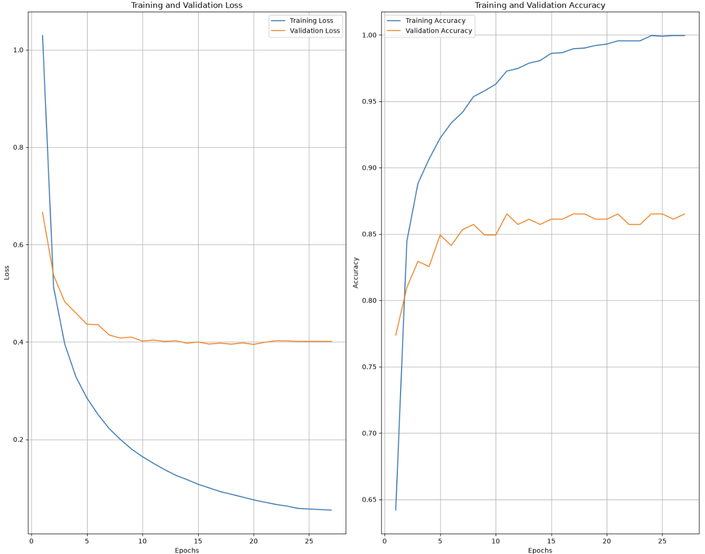
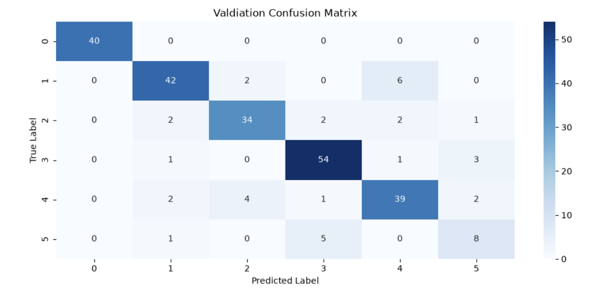
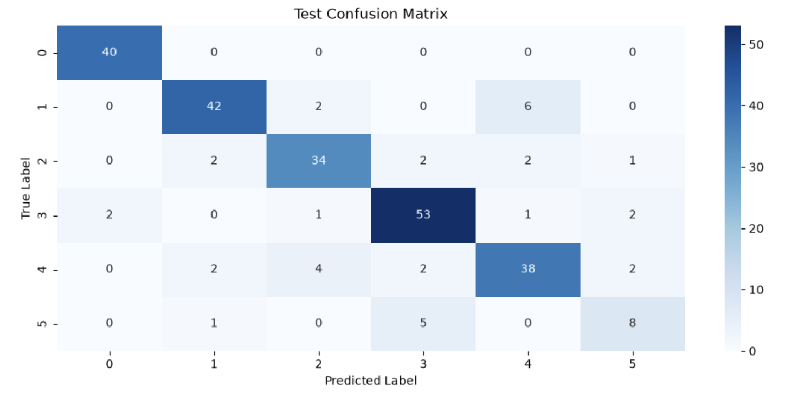
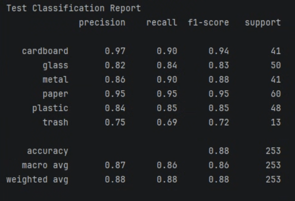

# Environment Scan

## Project Description

Environment Scan is a computer vision application developed to identify and track waste materials using computer vision. Built with Streamlit, the application allows users to upload images or capture photographs directly through their camera. A trained TensorFlow/Keras computer vision model processes the image and predicts its corresponding material category.

Following each prediction, the application automatically updates an inventory of identified materials. It also displays prediction confidence scores, individual material counts, and a pie chart illustrating the distribution of recorded waste categories.

The goal of this project is to explore how computer vision can be applied to waste identification and material tracking.

## Table of Contents

- [Features Overview](#features-overview)
- [Computer Vision Explanation](#computer-vision-explanation)
- [Application and Inventory Tracking](#application-and-inventory-tracking)
- [Data Storage](#data-storage)
- [UI Framework](#ui-framework)
- [Technologies Used](#technologies-used)
- [Installation and Running](#installation-and-running)
- [Future Improvements](#future-improvements)
- [Contributors](#contributors)

## Features Overview

- Streamlit interface for uploading images and capturing photographs.
- Computer vision model integration for waste material classification.
- Prediction results displaying the identified material and model confidence.
- Automatic inventory updates following each successful prediction.
- Persistent inventory storage using JSON.
- Material counters displaying the number of identified items per category.
- Pie chart visualization showing the distribution of identified materials.
- Inventory reset functionality.

## Computer Vision Explanation
Environment Scan Project utilizes a transfer learning convolutional neural network (CNN)
model to classify objects in images as trash or recyclable objects. More specifically, there
are six classes the model can classify objects as: cardboard, glass, metal, paper, plastic,
and trash. Evironment Scan Project uses a complete computer vision model pipeline to clean the TrashNet
dataset of images, split the dataset into train, validation, and test sets, train the model, and evaluate the model.

### Cleaning
First, the "resize_images" function navigates through all of the subdirectories for each class
and resizes every image to 224x224 pixels. This size makes the matrix operations that occur in the convolution layer of 
the CNN simpler. The "remove_duplicates" function then uses SHA1-Hash codes to identify and remove identical 
images from the dataset. This helps prevent overfitting. Next, a pair of nested for loops are used to navigate 
through all the sub-directories in the TrashNet dataset and append the filepaths of the images and their labels to two 
lists, which are then converted to NumpY arrays. These arrays are used for splitting the dataset into training, 
validation, and test sets later. Next, the "counts" dictionary is used to store the number of images in each class 
directory for dataset feature distribution analysis.

### Dataset Splitting
"train_test_split" from scikit-learn is used to split the dataset into 80% training, 10% validation, and 10% test sets.
The training set is used for the model to learn on during training. The validation set is used to evaluate model performance,
and tune hyperparameters as needed. The test set serves as the final evaluation of unseen data for the model. Stratification
is used to preserve the class distrubution across the train, validation, and test sets. This prevents any of these sets from
having a disproportionate amount of a particular class. The six classes are then encoded as integers (0-5) so they can be predicted
by the model. The training, validation, and test sets are converted into TensorFlow datasets so they can be used with the TensorFlow
based model.

### Data Augmentation
Data augmentation is used in CNNs to improve their ability to generalize on unseen data by replicating the realistic visual 
diversity of objects and their positioning in images. In this model pipeline, random images from the training set are horizontally 
flipped, rotated, zoomed in, and have their contrast increased.

### EfficientNet-B0 and Transfer Learning
EfficientNet-B0 is a pre-trained CNN model that has been trained on a large dataset of images. Using EfficientNet-B0 in this
project allowed us to use the feature extraction capabilities of a well trained, powerful model and tailor it to our needs by freezing the feature
extractor so its weights remain constant during training. We trained the classifer on TrashNet so it learns how to detect the classes
in this dataset. Put simply, we are getting the feature extraction capabilities of a powerful, pre-trained model and tailoring it's classifier for our
needs. This processor of using a pre-trained model designed for one task, and modifying it to work on another, related task is called
transfer learning.

### Model Evaluation


To evaluate our model, we plotted training and validation loss and accuracy over epochs to see the model's convergence, plotted the
validation and test confusion matrices, and printed the validation and test classification reports. The model convergence plots indicate
that the model is learning effectively, but overfits in later epochs. The training accuracy and loss smoothly converge to 1.0 and 0.0 
respectively. The validation loss converges to 0.4 and the validation accuracy converges to roughly 0.86. The more jagged validation accuracy curve
is likely due to the small validation and test set sample size, as TrashNet is a smaller dataset. Classifying even a few observations wrong can substantially
impact its score, leading to a more jagged line.




Both the validation and test confusion matrices indicate that despite experiencing overfitting, the model was able to correctly identify the vast majority
of unseen samples.




The test classification report indicates strong classification performance on the first five classes (cardboard, glass, metal, paper, and plastic), but weaker
performance on the trash class. This may be because there were far less trash samples in the TrashNet dataset for the model to learn on compared to the other classes, or
the dataset's samples are more visually diverse compared to the other classes. F1-Scores of 0.85-0.94 on the non-trash classes is very good to excellent performance, but 
the 0.72 F1-Score on the trash class is poor to moderate.


## Application and Inventory Tracking

After the computer vision model generates a prediction, the application updates its material inventory.

Python's `Counter` class is used to maintain the number of identified items within each material category. Each successful prediction increases the corresponding material count by one.

For example, if the model identifies an image as plastic, the plastic counter increases by one.

The application uses Streamlit's session state (`st.session_state`) to maintain the inventory during an active session. This allows the counters to remain accessible as Streamlit reruns the application following user interactions.

The dashboard displays the individual material counts, total number of recorded items, and a pie chart representing the distribution of identified materials.

## Data Storage

The application uses JSON to store inventory data locally in a file named `inventory.json`.

Python's `json` module is used to serialize the inventory dictionary and save it to the file. When the application starts, it checks whether an existing inventory file is available and loads its contents.

This allows previously recorded material counts to persist between application sessions without requiring users to manually re-enter their data.

The current implementation uses local file storage rather than a database.

## UI Framework

Streamlit was selected as the UI framework because it allows interactive web applications to be developed directly using Python.

The application uses Streamlit components for image uploads, camera capture, buttons, notifications, columns, and material counters.

Custom CSS is also incorporated to modify the application's appearance, including its background, typography, colors, buttons, and other interface elements.

Matplotlib is used to generate the pie chart displayed in the inventory dashboard.

## Technologies Used

| Technology | Purpose |
|---|---|
| Python | Core application logic |
| Streamlit | User interface and application framework |
| TensorFlow / Keras | Computer vision model integration and prediction |
| NumPy | Numerical image processing and prediction handling |
| Pillow (PIL) | Image loading, conversion, and resizing |
| Matplotlib | Inventory data visualization |
| JSON | Persistent inventory storage |
| pathlib | File and directory management |
| Git / GitHub | Version control and collaboration |

## Installation and Running

### Prerequisites

- Python installed
- pip package manager
- Git installed
- Trained computer vision model (`efficient_net.keras`)
- Material class directories (`new_data/`)

### 1. Clone the Repository

```bash
git clone YOUR_REPOSITORY_URL
cd YOUR_PROJECT_DIRECTORY
```

### 2. Install Dependencies

```bash
pip install streamlit tensorflow numpy pillow matplotlib
```

### 3. Verify Project Files

Ensure that the trained model file and material class directories are available in the project directory.

The expected structure is:

```text
Environment-Scan/
│
├── app.py
├── efficient_net.keras
│
├── new_data/
│   ├── cardboard/
│   ├── glass/
│   ├── metal/
│   ├── paper/
│   ├── plastic/
│   └── trash/
│
├── inventory.json
│
└── README.md
```

The material directory names must correspond to the model's training classes and their expected output order.

### 4. Run the Application

```bash
streamlit run app.py
```

Streamlit will launch the application and provide a local URL that can be opened in a web browser.

## Future Improvements

- Implement object detection to identify and count multiple waste objects within a single image.
- Improve classification accuracy and evaluate model performance.
- Introduce a database for more reliable long-term inventory storage.
- Implement historical tracking to monitor material identification over time.
- Expand material categories and improve classification capabilities.
- Develop additional visualizations and waste analytics.

## Contributors

Developed collaboratively as a hackathon project focused on applying computer vision and machine learning to waste identification and tracking.

Add contributor names and their respective contributions here.

### Nathan Spear
- Developed computer vision pipeline
- Compared custom CNN and EfficientNet-B0 transfer learning model performance
- Used evaluation metrics to report transfer learning model's performance
- Helped organize GitHub repository
- Implemented Gemini fun recycling fact feature

## References
Ozkefe, Feyza. (n.d.). *TrashNet*. Kaggle. https://www.kaggle.com/datasets/feyzazkefe/trashnet
